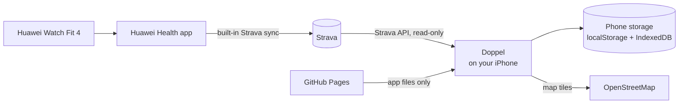
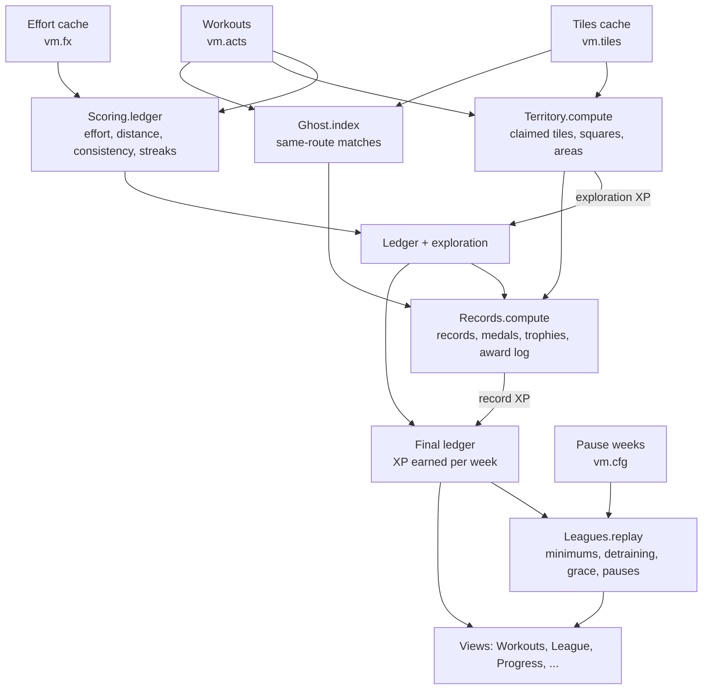

# Doppel

**You vs you. Get better than past you.**

A running app for iPhone where your only rival is who you were yesterday. Your workouts become XP and a ranked ladder of 12 leagues, records, medals and trophies, a territory map, and races against past you on the same routes. Your guide is **Doppel**, a ghost in a sweatband and running shoes: past you, waiting to be beaten. It reads your training from Strava, runs entirely on your phone, and costs nothing to host.

> Built for a Huawei Watch Fit 4 → Huawei Health → Strava setup, but it works with any device that syncs to Strava.

---

## Contents

1. [What it is](#what-it-is)
2. [How it works, in one picture](#how-it-works-in-one-picture)
3. [A tour of the app](#a-tour-of-the-app)
4. [XP: how it's earned](#xp-how-its-earned)
5. [Records](#records)
6. [Medals and trophies](#medals-and-trophies)
7. [Territory](#territory)
8. [Racing past you](#racing-past-you)
9. [Levels and leagues](#levels-and-leagues)
10. [The art system](#the-art-system)
11. [Strava attribution](#strava-attribution)
11. [Your data, privacy and backups](#your-data-privacy-and-backups)
12. [Syncing with Strava](#syncing-with-strava)
13. [Architecture](#architecture)
14. [File reference](#file-reference)
15. [Setup](#setup)
16. [Development](#development)
17. [Known limitations](#known-limitations)
18. [Open questions and ideas](#open-questions-and-ideas)

---

## What it is

Doppel is a **progressive web app**: a website that installs to the iPhone home screen and behaves like a native app (full screen, offline, its own icon). There is no server and no account system. The app is a set of static files hosted on GitHub Pages; everything personal lives in the phone's own storage.

It answers one question after every workout: *what did that session earn me?* The answers come in a few deliberately different forms:

| Layer | What it rewards | Feeds into |
|---|---|---|
| **XP** | Effort, distance, consistency, records, exploration | Your level and league |
| **Leagues** | Training consistently enough to climb, and to stay | 60 levels across 12 leagues, which you can also lose |
| **Records** | Getting faster or going further | Bonus XP |
| **Medals** | Repeatable feats and habits, bronze → silver → gold | Nothing; they hang on your medal wall |
| **Trophies** | Ten once-off, hard milestones | Nothing; they stand on your trophy shelf |
| **Territory** | Running somewhere new | XP per new tile |
| **Racing past you** | Beating your past self on the same route | A race, and the Overtaker medal |

Everything is **derived from your workout history**. Nothing is stored as "you are level 13"; the app replays your workouts every time. That's why you can change any rule and your whole history is re-scored consistently.

---

## How it works, in one picture



1. You record a workout on the watch. Huawei Health syncs it to Strava automatically.
2. When you open Doppel (or tap **Sync**), it asks Strava for anything new.
3. The app fetches the details it needs (heart rate, best efforts, GPS route), stores them on the phone, and runs its engines: scoring, records, medals and trophies, territory and same-route matching.
4. Everything you see is computed on the phone, from that local data.

GitHub Pages only serves the app's code. Your workouts, tokens and settings never go there.

---

## A tour of the app

The bottom bar has five buttons:

| Icon | Tab | What's there |
|---|---|---|
| Pulse line | **Workouts** | Your league badge, level and XP bar, streak, trophy count, weekly and monthly running, this week vs last-week you, and the filterable workout list |
| Trophy | **Progress** | Trophy shelf, medal wall, the territory card, and your records |
| Shield | **League** | Your badge and rank, this week's minimum, the next league, the ladder, XP history and pause weeks |
| Arrows | **Sync** | Fetches new workouts from Strava (asks first) |
| Sliders | **Settings** | Appearance, Strava, goals, scoring rules, backup and data |

### Workouts (home)
- **Rank:** your league badge, league and division (e.g. *Jogger III*), level and an XP bar to the next level.
- **Streak card:** the pulse-flame icon with weeks in a row of 3+ workouts, the XP boost it gives, and three marks for this week's workouts.
- **XP card:** XP earned this week. If your league has a weekly minimum, a line under the cards says how much is left to hold your league.
- **Trophy case** (top right): your latest trophy and how many of the 10 you've won. Tap it to open Progress.
- **Running this week / this month:** side by side, each with a bar toward its goal (weekly and monthly km goals are set under **Settings → Goals**).
- **You vs last-week you:** how far you've run this week against how far you had run by the same moment last week. Doppel looks smug when past you is ahead, and worried when you are.
- **Workout list:** with filters:
  - **Type chips:** All, Runs, Walks, Rides, Strength, Other. Only the types you have are shown.
  - **Period:** All time, This week, This month, 30 days, This year.
  - **Show:** Everything, Records, Ghost wins, New tiles, With route.
  - **Sort:** Newest, Oldest, Distance, Duration, XP, Pace, Heart rate.
  - **Summary:** a line totals the filtered set. Choices are remembered.

### A workout
Tap any workout to see:
- **Map:** the route, with any territory tiles that run claimed.
- **Stats:** distance, moving time, pace or speed, calories, average and max heart rate, elevation.
- **XP breakdown:** every line that earned XP (effort blocks, distance, streak boost, consistency, records, exploration).
- **Race past you card:** if you've run this route before.
- **Heart-rate chart:** with your effort zone shaded, so you can see where XP was earned.
- **Kilometre splits:** for runs and walks.

### Progress
The trophy shelf, the medal wall, the territory summary and your records. Tap any medal or trophy for its rule, your progress and the workout that won it.

---

## XP: how it's earned

XP (the hexagon-and-bolt icon) is built from five ingredients. Each is designed to reward a *different* behaviour, so the same effort isn't paid twice.

| Ingredient | Rewards | Default |
|---|---|---|
| Effort | Sustained time with your heart rate in the effort zone | 10 XP per 10 continuous minutes, +25 per 30 |
| Distance | Volume | 4 XP/km running, 2 walking, 1 cycling |
| Consistency | Showing up regularly | +15 for the week's 3rd workout, +25 for the 4th, streak boost |
| Records | Getting faster or going further | +50 per beaten record, +30 per new longest run |
| Exploration | Running somewhere new | +2 per new territory tile |

Calories are shown but never scored: they're the least accurate number a watch produces.

### 1. Heart-rate zones

Zones use **heart-rate reserve** (the Karvonen method), which adapts to your fitness through your resting heart rate:

$$HR_{\max} = 208 - 0.7 \cdot \text{age} \qquad \text{(Tanaka)}$$

$$T_p = HR_{\text{rest}} + p \cdot \left(HR_{\max} - HR_{\text{rest}}\right)$$

With the defaults (age 22, resting 60 bpm, effort zone at $p = 40\%$, vigorous at $p = 60\%$):

$$HR_{\max} = 192.6 \text{ bpm}, \qquad T_{\text{effort}} \approx 113 \text{ bpm}, \qquad T_{\text{vigorous}} \approx 140 \text{ bpm}$$

You can enter a measured max heart rate instead of the estimate.

### 2. Effort blocks

The app walks through the second-by-second heart rate of each workout and finds **continuous blocks** of time above the effort threshold:

- A dip below the zone of up to **60 seconds** (a traffic light, a water stop) doesn't break the block. The dip itself earns nothing.
- Seconds in the **vigorous** zone count **1.5×**, so harder effort fills blocks faster.

For a block with effective minutes $t$:

$$P_{\text{effort}} = 10 \cdot \left\lfloor \frac{t}{10} \right\rfloor + 25 \cdot \left\lfloor \frac{t}{30} \right\rfloor$$

A **daily cap of 90 effective minutes** stops the system from rewarding overtraining.

### 3. Distance

$$P_{\text{distance}} = \text{rate} \times \text{km}$$

with the rate set by activity type (running 4, walking and hiking 2, cycling 1, anything else 2).

### 4. Consistency

- A workout counts toward consistency if it's at least **15 minutes** long.
- The week's **3rd** workout earns **+15** and the **4th** earns **+25**. After that the bonuses stop on purpose.
- **Streak boost** (the pulse-flame icon): every *consecutive previous* week with 3+ workouts adds **+5%** to this week's effort and distance XP, up to **+25%**:

$$m = 1 + \frac{\min(25,\ 5 \cdot n_{\text{streak}})}{100}$$

- **Rest bonus:** a completed day with no workout after **3 consecutive active days** earns **+10**. Rest is part of training.

### 5. Putting it together

For one workout:

$$P = \text{round}\!\left(\left(P_{\text{effort}} + P_{\text{distance}}\right) \cdot m\right) + P_{\text{consistency}} + P_{\text{records}} + P_{\text{exploration}}$$

**Worked example:** a 30-minute 5 km run with 28 continuous minutes in the zone, 12 of them vigorous, with no streak and no records:

$$t = 16 + 1.5 \cdot 12 = 34 \text{ min} \;\Rightarrow\; P_{\text{effort}} = 10 \cdot 3 + 25 \cdot 1 = 55$$

$$P_{\text{distance}} = 4 \cdot 5 = 20 \qquad\Rightarrow\qquad P = 75$$

### Everything is adjustable

**Settings → XP and leagues** has a page per group (heart-rate zones, effort, distance, consistency, records, exploration, leagues). Changed values are outlined, each section can be reset, and **any change re-scores your entire history immediately**.

---

## Records

Records come from Strava's **best efforts**: the fastest 1 km, 5 km, 10 km and half marathon *inside* any run. A fast 5 km in the middle of a 10 km run counts.

| Record | Bonus when beaten |
|---|---|
| 1 km, 5 km, 10 km, half marathon | +50 |
| Longest run | +30 |
| Most running in a week | shown only |
| Longest streak | shown only |

The **first** time you run a distance, it sets the record without a bonus. Only *beating* a record pays, so XP can't be farmed just by covering a distance once.

---

## Medals and trophies

Medals and trophies are **achievements, not currency**. They never add XP. Both are re-derived from your full history, like everything else.

### Medals: the medal wall
Medals are **repeatable**. Each one counts up every time you earn it, and its disc turns **bronze → silver → gold** as the count passes its tier thresholds (silver and gold also get one and two stars). The ribbon keeps the medal's own colour.

| Medal | Earned | Silver / Gold at |
|---|---|---|
| **Record Breaker** | Every new personal record | 10 / 25 |
| **Overtaker** | Every time you beat past you on a repeated route | 10 / 25 |
| **Ten K** | Every run of 10 km or more | 10 / 25 |
| **Half Marathon** | Every run of 21.1 km or more | 5 / 12 |
| **Century** | Every 100 km of running | 5 / 10 |
| **Ten Pack** | Every 10 workouts | 5 / 10 |
| **Streak Keeper** | Every 4 weeks of streak (3+ workouts a week) | 3 / 6 |
| **Hour of Power** | Every 60-minute effort block | 10 / 25 |
| **Red Zone** | Every workout with 30+ vigorous minutes | 10 / 30 |
| **Engine Week** | Every week with 150+ minutes in your effort zone | 8 / 20 |
| **Explorer** | Every 100 new territory tiles | 5 / 15 |
| **Climber** | Every 1,000 m climbed | 5 / 15 |
| **Early Bird** | Every 10 workouts started before 07:00 | 5 / 10 |
| **Recovery** | Every 5 rest-day bonuses | 5 / 12 |

### Trophies: the trophy shelf
Trophies are **once-off and hard**: each is a line past you never crossed. Every trophy is the same gold cup with its own emblem and gem; unwon ones stand on the shelf as silhouettes with a progress bar.

| Trophy | To win it |
|---|---|
| **Marathon** | Run 42.2 km in one go |
| **Faster Than Then** | Run 5 km at least 10% faster than your first 5 km on record |
| **Thousand Club** | Run 1,000 km in total |
| **Unbroken** | Hold your streak for 26 weeks in a row |
| **Ghost Hunter** | Beat past you on 10 different routes |
| **Big Week** | Run 75 km in a single week |
| **Everest** | Climb 8,849 m in total |
| **Cartographer** | Explore 2,500 territory tiles |
| **Dawn Patrol** | Start 50 workouts before 07:00 |
| **Hundred Hours** | Spend 100 hours in your effort zone |

For *Faster Than Then*, the improvement is

$$\text{gain} = \frac{t_\text{first 5 km} - t_\text{best 5 km since}}{t_\text{first 5 km}} \times 100\% \geq 10\%$$

A route for *Ghost Hunter* is identified by the first run on it, so beating past you twice on the same loop counts once.

### Celebrations
- **Meet Doppel:** the first time the app opens after an update to Doppel (or on a new install), Doppel introduces itself instead of flooding you with every medal from your history.
- **After a sync:** a single new medal swings in on its ribbon ("Upgraded to Silver" when it changes tier); a trophy rises onto the screen with a sunburst while Doppel looks on in shock; several awards show as a grid with Doppel cheering.
- **Replay latest** on the Progress page replays your three most recent awards as a demo.
- Level and league changes follow straight after.
- **Reduce Motion:** if it's on in iOS, cards appear without animation.

---

## Territory

The whole world is divided into a fixed grid of tiles (the standard web-map grid at zoom level 17). A tile is about

$$\frac{40\,075\,017 \text{ m} \cdot \cos(\text{latitude})}{2^{17}} \approx 305.7 \text{ m} \cdot \cos(\text{latitude})$$

across, which is about **275 m in Pretoria**. The grid works anywhere on Earth, with no map lookups.

- **Claiming:** any route that passes through a tile you've never visited **claims** it, worth **+2 XP**. Running your usual loop again earns nothing new, which is the point: it pushes you to explore.
- **Tracing:** routes are traced at quarter-tile resolution. Gaps longer than 2 km (GPS dropouts) aren't filled in.
- **Stats:**
  - **Tiles claimed** and **new this week**.
  - **Largest area:** your biggest connected patch of tiles.
  - **Biggest square:** the largest solid *k × k* block with no gaps. Filling in holes grows it.
- **Map views:** Home area (your largest patch), Everywhere, and Biggest square. Zoomed out, each separate area shows as a marker with its tile count.

---

## Racing past you

Run the same route twice and past you, Doppel, is waiting to race.

**How routes are matched.** Two runs are the same route when their territory tiles overlap strongly and their distances are close:

$$J(A, B) = \frac{|A \cap B|}{|A \cup B|} \geq 0.6 \qquad\text{and}\qquad |d_A - d_B| \leq 15\%$$

Direction doesn't matter: a loop run the other way still matches. No naming or setup is needed.

**On a workout.** A **Race past you** card compares your pace with the last time you ran the route, and tells you how many times you've run it.

**The race page:**
- **Opponent:** race **Last time** or **Your best here**.
- **Verdict:** e.g. "You beat past you by 1:05", with a short race story (biggest lead, comebacks, where it was decided).
- **Replay:** you and Doppel move along today's route on the map at 90× speed, with a live clock and the gap in metres.
- **Gap chart:** your lead or deficit over the whole distance.
- **Kilometre table:** your split vs past you's, and the running gap.

The comparison uses **elapsed** time, so stops count, as they would in a real race.

---

## Levels and leagues

XP drives a ranked ladder: **60 levels in 12 leagues** of five divisions each (e.g. *Pacer IV*). Every league badge is the same shield, so they read as one family; grandeur builds gradually: the metal changes (grey, bronze, copper, silver, emerald, teal, sapphire, amethyst, ruby, gold, platinum, prismatic), then a bevel, a chevron and a gem are added, wings grow from Pacer, laurels from Harrier and a crown from Ultra, with a glow and shimmer at Elite and rotating rays at Legend. Only your current league and the **next one** are revealed; everything above stays hidden until it's next.

| # | League | Levels | XP to enter | Weekly minimum |
|---|---|---|---|---|
| 1 | Couch | 1–5 | 0 | none |
| 2 | Starter | 6–10 | 380 | none |
| 3 | Jogger | 11–15 | 1,490 | 40 |
| 4 | Strider | 16–20 | 3,900 | 70 |
| 5 | Pacer | 21–25 | 8,080 | 100 |
| 6 | Tempo | 26–30 | 14,490 | 140 |
| 7 | Threshold | 31–35 | 23,550 | 190 |
| 8 | Harrier | 36–40 | 35,660 | 250 |
| 9 | Marathoner | 41–45 | 51,190 | 320 |
| 10 | Ultra | 46–50 | 70,500 | 400 |
| 11 | Elite | 51–55 | 93,960 | 500 |
| 12 | Legend | 56–60 | 121,920 | 600 |

### The level curve

Each level costs more than the one before:

$$\text{XP}(L \rightarrow L{+}1) = 50 + 5.5\,(L-1)^{1.75} \quad\text{(rounded to 10)}$$

That's 50 XP for the first level, about 1,600 by level 25, and about 7,000 near the top: 147,740 XP to reach level 60.

### Losing XP

XP reflects *current* training, not just history, so it can go down. Two rules apply to every **completed** week (Monday to Sunday):

1. **Weekly minimum.** From Jogger up, each league has a weekly minimum (table above). Finish a week below it and you **lose that minimum**. The rule is deliberately all-or-nothing: losing only the shortfall would let steady low training climb forever.
2. **Detraining.** A week with **no workouts at all** also costs **2% of your XP**, the way fitness fades.

Losing XP across a level boundary drops you a level; dropping below a league's first level drops the league.

**Protections:**
- **Week-end only:** the current week is never penalised until it's over.
- **Safe start:** Couch and Starter have no penalties.
- **Grace weeks:** the first 2 weeks after reaching a league are minimum-free.
- **Pause weeks:** pause up to 6 weeks a year for injury, illness or exams, with no minimum and no detraining. Only this week or last week can be paused.
- **Floor:** XP never goes below 0.

### Balance

Because missing the minimum costs the whole minimum, **steady training settles in the league whose minimum it can hold**, knocking on the next league's door. Climbing further means training more, not just training longer. Simulated over years of steady training:

| Steady weekly XP | Roughly | Settles in |
|---|---|---|
| ~70 | 2 easy runs | Strider / Pacer |
| ~150 | 3 runs of 5 km | Tempo / Threshold |
| ~300 | 4 runs with a long run | Harrier / Marathoner |
| ~450 | 5 runs, ~35 km | Ultra / Elite |
| 600+ for about 4 years | serious training | Legend |

Your rank is placed by replaying your whole history, so the first time you open the League tab you land where your past year honestly puts you.

### Celebrations

Placement, level-ups (XP bar fills), promotions (badge reveal with a sunburst) and drops (a calm card explaining what cost the XP) each get their own card. Re-entering a league you'd dropped from says *"Back in …"* instead of a full promotion. Medal and trophy celebrations come first, then rank changes.

### Tuning

**Settings → XP and leagues → Leagues** adjusts minimum strength (%), detraining (%), grace weeks and pause weeks per year. The level curve and league thresholds are fixed, so the top can't be reached by changing settings.

## The art system

Everything drawn in Doppel (the mascot, medals, trophies, league badges and icons) is generated as SVG in code from the same few rules, in `art.js` and `league-ui.js`, so it reads as one family:

- **Material:** one three-stop vertical gradient per object: a light tint, the base colour, a dark shade.
- **Rim:** a solid outline in that dark shade, with round joins.
- **Shine:** a single soft white highlight, top left.
- **Emblems:** 24-unit line icons with 2 px round strokes, in a contrasting ink.
- **Type:** rounded, heavy.

**Doppel** is a pale ghost whose body melts into a streaming tail when running. It wears a **sweatband and running shoes in your accent colour**, so it always matches your theme. It has seven moods: `run`, `cheer`, `smug`, `wow`, `sleep`, `sad` and `wave`. Doppel appears in the header, empty states, celebrations, the past-you card, the race page (its mood depends on who won) and on the map as the runner you're racing. The app icon is Doppel mid-stride.

---

## Strava attribution

Every screen that shows Strava data (workouts, a workout, ghost race, progress, territory, league) ends with the official **Powered by Strava** logo: `strava-powered-white.png` in dark mode and `strava-powered-black.png` in light mode, shown small at the bottom of the page.

## Your data, privacy and backups

**Everything stays on your phone.** There's no server, no analytics and no account.

| Data | Where | Leaves the phone? |
|---|---|---|
| Strava Client ID and Secret, access tokens | localStorage | Only to Strava, to sign in |
| Workouts, heart rate, routes | localStorage + IndexedDB | Never |
| Settings, XP rules, pause weeks | localStorage | Only in backup files you save yourself |
| Map tiles | Fetched from OpenStreetMap | Only the map area being viewed |

- **Persistent storage:** the app asks iOS to protect its storage from automatic clearing (see **Settings → Backup and data**). Deleting the app from the home screen deletes its data.
- **Backups:** **Save backup** opens the share sheet, so you can save the file to iCloud Drive or Files. It holds your settings, XP and league rules, pause weeks and appearance, but **not** the Strava secret. Workouts aren't included, because they re-sync from Strava. **Restore from backup file** brings everything back.
- **Sharing with friends:** each person installs from the same URL and connects their own Strava. Their data lives only on their phone; nothing is shared or stored centrally.

---

## Syncing with Strava

- **First sync:** pulls the last **12 months**. Later syncs ask only for workouts since the newest one you have (with a one-hour overlap).
- **When it syncs:** automatically when you open the app (at most every 10 minutes), and when you tap **Sync** (after a confirmation).
- **Extra requests per workout:** some features need more than the summary:
  - **Heart-rate stream:** for effort scoring.
  - **Workout detail:** for calories, splits, best efforts and the full GPS route.
  - **Distance + position stream:** for ghost races, fetched only when you open one.
- **Request budget:** Strava limits how many requests an app can make (around 100 reads per 15 minutes). Each sync spends at most **40** detail and stream requests, newest workouts first. Older workouts fill in over the next few syncs and show "scoring…" until then. Everything fetched is cached, so each workout is downloaded once.
- **Tokens:** they refresh automatically. You sign in to Strava once.

---

## Architecture

### Design principles

1. **Static and serverless.** Plain HTML, CSS and JavaScript, no build step and no framework. It is hosted free on GitHub Pages.
2. **Pure engines, thin UI.** Scoring, records, territory and ghost matching are pure functions in their own files: data in, results out, no DOM and no storage. They can be tested in Node and reasoned about in isolation.
3. **Derived, not stored.** XP, levels, leagues, records, medals, trophies, territory and ghost matches are all recomputed from workout history. Only raw inputs (workouts, streams, your settings and pause weeks) are stored, so changing a rule can never leave stale numbers behind.
4. **Cache the expensive parts.** Downloaded streams are cached in IndexedDB. Effort blocks (which depend only on heart rate and zone settings) are cached with a signature of those settings, and recomputed automatically when the settings change. Territory tiles are cached per workout.
5. **App-shell layout.** Only the content area scrolls; the bottom bar sits outside it. That keeps the bar pinned on iOS, where rubber-band scrolling otherwise moves fixed elements.

### How a screen gets its numbers



`getLedger()` in `app.js` runs this pipeline once and caches the result until data or settings change.

### Script load order

The page loads plain scripts in dependency order. The pure engines attach themselves to `globalThis`; the UI files use them at call time.

```
leaflet.min.js        maps (CDN)
scoring.js            → Scoring
leagues.js            → Leagues     (uses Scoring)
territory.js          → Territory   (uses Scoring)
ghost.js              → Ghost
records.js            → Records     (uses Scoring)
art.js                mascot, medal and trophy drawing
awards.js             medal wall, trophy shelf, celebrations, past-you card
race.js               ghost race UI
league-ui.js          badges, XP and streak icons, League page, rank celebrations
app.js                storage, Strava, sync, views, router, settings
```

### Navigation

The app is a single page with hash routes:

| Route | Screen |
|---|---|
| `#/` | Workouts (home) |
| `#/a/<id>` | Workout detail |
| `#/ghost/<id>?vs=prev\|best` | Ghost race |
| `#/progress` | Progress |
| `#/territory` | Territory map |
| `#/league` | League |
| `#/settings` | Settings menu |
| `#/settings/appearance`, `/strava`, `/goals`, `/scoring`, `/scoring/<group>`, `/data` | Settings pages |

### Storage

**localStorage** (small, synchronous):

| Key | Contents |
|---|---|
| `vm.cfg` | Settings: theme, accent, weekly goal, XP and league parameters, pause weeks, Strava Client ID/Secret |
| `vm.tok` | Strava access and refresh tokens, athlete name |
| `vm.acts` | Workout summaries (one compact record per workout) |
| `vm.meta` | Sync markers, last backup time, medals, trophies and rank already celebrated |
| `vm.fx` | Effort-block cache, with the settings signature it was computed for |
| `vm.tiles` | Territory tiles per workout, and whether they came from the full or simplified route |
| `vm.list` | Workout-list filters (per-phone convenience) |

**IndexedDB** (database `vitamin-me`, a name kept from the app's first version so caches survive, store `kv`), for larger data:

| Key | Contents |
|---|---|
| `d<id>` | Workout detail: calories, splits, best efforts, full route, device |
| `h<id>` | Heart-rate stream (time, bpm) |
| `r<id>` | Race stream (time, distance, position), for ghost races |

---

## File reference

```
vitamin-me/   (repository name)
├── index.html        Page shell, all styles and themes, dock, script tags
├── app.js            The application: storage, Strava auth and sync, views, router, settings
├── scoring.js        XP engine (pure)
├── leagues.js        Levels and leagues engine (pure)
├── records.js        Records, medals and trophies engine (pure)
├── territory.js      Territory grid engine (pure)
├── ghost.js          Same-route matching and race comparison (pure)
├── art.js            The art system: Doppel, medals, trophies
├── awards.js         Medal wall, trophy shelf, celebrations, past-you card
├── race.js           Ghost race page and replay
├── league-ui.js      Badges, icons, League page, rank celebrations
├── sw.js             Service worker: offline app shell
├── manifest.json     Home-screen install metadata
├── strava-powered-white.png / -black.png   Strava attribution logos
├── icon-180.png      Apple touch icon
├── icon-192.png      App icon
├── icon-512.png      App icon (large)
└── README.md         This file
```

| File | Role | Details |
|---|---|---|
| `index.html` | Shell and styles | Theme tokens for light and dark, accent colour variables, every component's CSS, the bottom bar, and a tiny pre-paint script that applies your saved theme before anything renders (no flash). |
| `app.js` | Application core | localStorage and IndexedDB wrappers; theme handling; Strava OAuth (including the Safari-code fallback); incremental sync with a request budget; detail, heart-rate and race stream fetching and caching; the effort and tile caches; `getLedger()` pipeline; all main views (home, workout detail, progress, territory, settings); workout filters; maps; HR chart; backup and restore; router. |
| `scoring.js` | Pure engine | `PARAMS` (every tunable number, which also generates the XP and leagues settings pages), heart-rate zones, effort-block detection from HR streams, and `ledger()`: per-workout breakdowns, weekly totals, streak multiplier, daily cap and rest bonus. |
| `records.js` | Pure engine | Record tracking from best efforts and distances, PR bonus events, medal definitions (colour, emblem, rule, tier thresholds), trophy definitions (rule and progress), counts and tiers, progress to the next one, and the chronological award log. |
| `territory.js` | Pure engine | Zoom-17 tile maths, route-to-tiles tracing, first-visit claiming, exploration XP, biggest-square search and connected areas. |
| `ghost.js` | Pure engine | Same-route index (tile Jaccard similarity and distance tolerance), interpolation of time at distance and distance at time, and the race comparison (gap curve, km splits, biggest lead or deficit). |
| `art.js` | Drawing | The shared material rules, `mascotSvg(mood)`, `medalSvg(medal, {tier})`, `trophySvg(trophy)` and the wordmark. Pure string builders. |
| `awards.js` | UI | Trophy case button, trophy shelf, medal wall, detail sheets, tracking what's been celebrated, the Meet Doppel intro, award celebrations, and the this-week vs last-week-you card. |
| `race.js` | UI | Race past you card on workouts, the race page, verdict and race story, gap chart, splits table, and the animated replay on the map. |
| `leagues.js` | Pure engine | League definitions and weekly minimums, the level curve, `rankOf(xp)`, and `replay()`: walks every week of history applying minimums, detraining, grace and pause weeks, returning the XP timeline, rank-change events and this week's status. |
| `league-ui.js` | UI | XP and pulse-flame streak icons, the 12 procedurally drawn league badges, the home rank hero, the League page (ladder, this week, next league, XP chart, pause weeks) and the placement, level-up, promotion and drop cards. |
| `sw.js` | Offline | Caches the app files so the app opens without a connection. Network-first, so updates arrive immediately when online. **Bump `VERSION` whenever files change.** |
| `manifest.json` | Install | Name, colours, icons, standalone display. |

---

## Setup

### 1. Host the app (once)
1. Put these files in a public GitHub repository.
2. **Settings → Pages → Deploy from a branch → `main` / root.**
3. The app is live at `https://<username>.github.io/<repo>/`.

### 2. Install on iPhone
Open the URL in **Safari**, tap **Share → Add to Home Screen**, and from then on always open it from the home screen.

### 3. Connect Strava (once per person)
Strava limits a new API app to its owner's account, so each person creates their own (free, about 5 minutes):

1. At [strava.com/settings/api](https://www.strava.com/settings/api), create an application. Set **Authorization Callback Domain** to `<username>.github.io`, with no `https://` and no path.
2. In Doppel, go to **Settings → Strava**, paste the **Client ID** and **Client Secret**, and tap **Save and connect Strava**.
3. Approve access on Strava's page, keeping **View data about your activities** ticked.

If iOS returns you to Safari instead of the app, the page shows a code. Copy it, open the app from the home screen, and paste it under **Settings → Strava → Use code**.

### 4. Make the data flow
In **Huawei Health → Me → Data sharing and authorization → Strava**, link your Strava account. New workouts then appear in Strava, and from there in Doppel. Huawei's sync isn't retroactive, so only workouts recorded after linking arrive.

---

## Development

**Run locally.** Any static server works:

```bash
python3 -m http.server 8000
# open http://localhost:8000
```

Strava sign-in needs the callback domain to match, so full sign-in only works on the deployed domain. Everything else can be tested locally with data in storage.

**Test the engines in Node.** The pure modules export themselves when `require`d:

```js
const Scoring = require('./scoring.js'); global.Scoring = Scoring;
const Territory = require('./territory.js');
const Ghost = require('./ghost.js');
const Records = require('./records.js');

const L = Scoring.ledger(activities, effortCache, {});   // XP earned
L.terr = Territory.compute(activities, tiles, {});        // territory
Territory.mergeIntoLedger(L, L.terr);
L.ghost = Ghost.index(activities, tiles);                 // same-route matches
const R = Records.compute(activities, L, {});             // records, medals, trophies
Records.mergeIntoLedger(L, R);
const Leagues = require('./leagues.js');
const G = Leagues.replay(L.weeks, {}, new Date(), []);    // XP after minimums/detraining, rank
```

**Deploy.** Push to `main`; GitHub Pages redeploys in about a minute.
1. Bump `VERSION` in `sw.js` with every change, or phones may keep serving the cached version.
2. On the phone, fully close and reopen the app to pick up the new version.

**Adding an XP or league parameter.** Add a row to `PARAMS` in `scoring.js` (`[key, default, label, unit, group, step]`). It appears in Settings automatically and is available as `p.key` in the engines.

**Adding a medal or trophy.** Medals go in `MEDALS` in `records.js`: a colour, an emblem (`icon` path or short `text`), `tiers` for bronze/silver/gold, an `n(state)` count and a `next(state)` progress function. Trophies go in `TROPHIES` with a `prog(state)` returning `[value, target]`. Track any new state in `compute()`; `art.js` draws them automatically.

---

## Known limitations

- **Strava is the source of truth.** If a workout doesn't reach Strava (or arrives without heart rate or GPS), Doppel can't score that part of it.
- **Heart-rate-based effort depends on the watch.** Wrist sensors can lag or spike; the 60-second dip tolerance and the vigorous threshold absorb most of it, and every threshold is adjustable.
- **Max heart rate is estimated from age** unless you enter a measured value.
- **Territory tiles start coarse.** Until a workout's full GPS route has been downloaded, its tiles come from Strava's simplified route.
- **Ghost races use elapsed time**, so long stops count against you, unlike Strava's moving time.
- **One device.** Data lives on one phone; moving to a new phone means restoring a backup file and re-syncing Strava.

---

## Open questions and ideas

- **Monthly challenges.** One self-set target per month with an XP bonus.
- **Strength and other sports.** XP is run-centric; strength sessions currently earn only through heart rate.
- **League seasons.** An optional seasonal reset or "season best" badge, as in ranked game modes.
